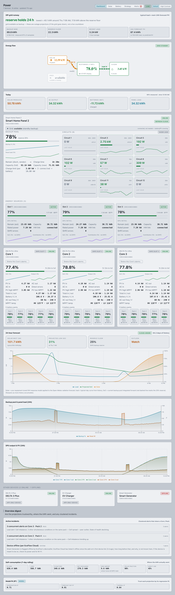

# Power — EcoFlow off-grid monitoring, forecasting & life-safety alarm

**Power** (Home Assistant add-on, slug `ecoflow_panel`) turns a cloud-only
EcoFlow off-grid system into a fully-instrumented, self-learning **control room**
— with a **battery-depletion life-safety alarm** at its center.

It ingests EcoFlow IoT-Open telemetry (HMAC-SHA256-signed REST + live MQTT),
persists a per-metric SQLite time-series, runs **~40 analytics engines** in a
worker thread, and serves the results three ways: a **React dashboard**, a
**telnet "control-room" TUI**, **~90 Home Assistant MQTT-discovery entities**
(sensors, binary sensors, and alarm-priority switches — plus dynamic
per-circuit sensors and the Energy Dashboard). When the pack is
projected to reach its reserve floor, it raises an **audible alarm** — chimes +
text-to-speech over Home Assistant media players and a SIP intercom.

The reference deployment is a Phoenix, AZ off-grid home: an EcoFlow **Smart Home
Panel 2**, three home **Delta Pro Ultra** battery/inverter Cores (5 packs each =
92 kWh usable), a **42-panel / ~16.8 kW** array, and an EVSE — on the APS R-EV
time-of-use rate.

> 📖 **Full reference:** [`ecoflow_panel/DOCS.md`](ecoflow_panel/DOCS.md) (~11,650
> lines) documents **every** feature and engine — what each does, the exact
> algorithm and math it computes, how data traces through the pipeline, its
> endpoints/sensors, config knobs, and edge-case guards. This README is the tour;
> DOCS.md is the manual.
>
> 🖨️ **Offline / printable:** a single-file **`.docx` and `.pdf`** build of this
> README + `SECURITY.md` + the full `DOCS.md` (with a linked table of contents)
> is attached to every [GitHub Release](https://github.com/tesseractAZ/power/releases).
> Regenerate locally with `python3 scripts/build-docs-docx.py` (needs `pandoc`;
> the PDF additionally needs LibreOffice).

---

## Screenshots

Live captures from the reference deployment. **Device serial numbers are masked to
their product-family prefix and circuit names are replaced by their shed-order index**
(`Circuit 1`…`Circuit 6`); everything else — telemetry, charts, layout, alert text — is
exactly what the app renders.

| | |
|---|---|
| [**Dashboard**](docs/screenshots/dashboard.png) — off-grid runway, energy-flow sankey, the SHP2 and every DPU Core with per-pack state, 24 h forecast, and the clustered-incident digest | [**Solar**](docs/screenshots/solar.png) — per-Core PV, the GHI→PV response model against its clear-sky ceiling, and weather-normalised soiling |
| [**Battery**](docs/screenshots/battery.png) — per-pack state-of-health, end-of-life projection, internal-resistance trend and cell-spread | [**Strategy**](docs/screenshots/strategy.png) — tonight's night-charge plan, EV-window prediction, load-shed order and the TOU charge schedule |
| [**Alerts**](docs/screenshots/alerts.png) — the alert console: standing conditions, severity, source engine and cleared history | |

[](docs/screenshots/dashboard.png)

> The Strategy capture above is the live plant on 2026-09-11 reading
> *"No plan tonight — forecast/telemetry basis incomplete; nothing will be charged."*
> That is not a placeholder: PV band coverage sat at 72% against the advisor's 78%
> basis gate, so the engine declined to size a buy. See
> [`docs/PERFORMANCE.md`](docs/PERFORMANCE.md) §2.

---

## What it does — at a glance

**Telemetry & history**
- Reverse-engineered EcoFlow cloud MQTT ingest (per-SN raw merge across `cmdId`
  1/2/4/21/28) → a unified snapshot for every DPU Core, the SHP2, and the EVSE —
  including **SHP2-attributed data for Cores whose Wi-Fi is down**.
- SQLite time-series (adaptive interval + value-epsilon dedup; retention
  configurable via `RECORDER_RETENTION_DAYS`, default 30 days, up to 10 years)
  and monotonic lifetime-energy accumulators wired into the HA Energy Dashboard.

**Forecasting**
- Per-hour-of-day **GHI→PV response model** (OLS, brightness/sample-gated) fed by
  an Open-Meteo + NWS weather ensemble, plus a **recursive Bayesian** variant.
- Day-ahead PV + load + **projected state-of-charge** curve, a self-calibrating
  **P10/P90 probability band**, a **4-day** horizon, and a **forecast-skill**
  backtest (predicted-vs-actual daily kWh: MAE, bias, r²).
- A **first-principles clear-sky** PV ceiling that cross-checks the learned model.

**Battery & PV health engines**
- Per-pack **State-of-Health** (Kalman filter vs raw BMS), **end-of-life**
  projection (fade-rate-ceilinged to kill false-EOL), a **hierarchical-Bayesian**
  SoH cross-check with 2σ outlier detection, and an **LFP open-circuit-voltage →
  SoC** estimate gated on pack rest.
- **Pack-risk** classifier (heuristic + an ML logistic-regression / isolation-
  forest v2), **internal-resistance** trend, **round-trip** and **coulombic**
  efficiency, **charge-curve** fingerprinting, ambient-coupled **thermal
  forecast** + event counter, **string-mismatch**, and per-Core weather-
  normalized **PV soiling** decomposition.

**Energy, economics & dispatch**
- Self-consumption decomposition (solar fraction, PV→load/battery), carbon
  accounting, time-of-use tariff + cost, and clipping/curtailment. The cost
  engine and the dispatch planner share one resolved rate basis — an explicit
  override, else a **confirmed** seasonal utility table, else a flat default.
  An unconfirmed table is refused rather than assumed, and the basis in force is
  published alongside the numbers.
- A **night-charge TOU-arbitrage engine** with an owner-selected write posture
  (`NIGHT_CHARGE_MODE: advisory | supervised | auto`, default advisory — never
  writes): on a night a shortfall is anticipated, it sizes "buy N kWh → charge
  to X% in the cheap overnight window" so the pack holds `reserve + outage
  cushion` — worst-case sized (P10 solar / P90 load), with the charge cap modeled
  as charge-only (the home rides grid bypass while the charger runs). The **outage
  cushion is the energy to carry the *islanded* load** — the Smart Home Panel's own
  backup circuits, which are what actually run when the grid drops — for a bounded
  outage (`ARB_OUTAGE_CUSHION_HOURS`, default 4). Sizing it against whole-house
  consumption instead described an island the hardware cannot create, and made the
  requirement permanently unsatisfiable. **Supervised mode** performs one announced, cancellable,
  bounded reserve write per charge night (clamped to the device's 10–50% range,
  armed only after an announcement channel confirms delivery, auto-reverted
  after the window, audit-logged). It **learns from night one**: a durable
  ledger records each plan, its measured delivery, and its outcome, and a
  fail-closed write-readiness gate graduates **auto** mode only on real
  actuated-night evidence (≥21 scored nights, under-buy ≤10%, sizing bias in
  [0, 5] kWh, band coverage 78–92%, zero engine-fault strikes).
  `ARB_OBJECTIVE` selects the sizing objective: **`resilience`** buys exactly the
  requirement, **`cost`** treats that requirement as a floor and fills further
  toward a solar-headroom or state-of-charge ceiling — bounded below by the
  resilience answer, so the safety margin can never shrink when the objective
  changes. Two honest caveats, both documented in
  [`docs/NIGHT_CHARGE_ARBITRAGE_DESIGN.md`](docs/NIGHT_CHARGE_ARBITRAGE_DESIGN.md):
  cost mode **fills further, it does not price** — it reads no tariff — and the
  reserve write itself is capped by the device at 50%. Since v1.165.0 a cost-mode
  ceiling (`ARB_COST_MAX_SOC_PCT`) above 50% is delivered in supervised/auto mode by
  the panel's per-channel force-charge. It switches on just in time, in the last
  stretch of a night whose reserve write applied and verified, and off at the target
  or the window close.
- Two advisory round-trip-aware dispatch planners (greedy + a model-predictive
  DP), compute-only, never auto-applied.

**Alarms & learning**
- Threshold + four families of **learned** alerts (peer-comparison, self-baseline,
  degradation/runtime forecast, solar/load forecast), an alert **monitor**
  (transition debounce, incident clustering, churn auto-silence, quiet hours),
  a **repair-issues** feed, and an **online learning loop** (feature snapshots →
  realized outcomes → shadow models).
- **Notifications are Home-Assistant-native** and opt-in: with `NOTIFY_CHANNEL: ha` (the
  shipped default, `none`, sends nothing) every alert becomes a card in the HA
  notification drawer (dedupe + morning digest, dismissed when the condition clears)
  and, for each service named in `NOTIFY_HA_PUSH_TARGETS`, a real push to the
  companion app. **Critical alerts — and only critical ones — carry the companion
  app's documented critical payload**, so a genuine battery, reserve-floor or
  grid-loss emergency sounds through Do Not Disturb and the silent switch; warnings
  arrive as ordinary pushes that respect the phone's settings. There is no second
  delivery stack to configure or keep alive.
- The **safety-critical runway engine**: an hour-by-hour DC-bus depletion sim
  (accounting for the DC→AC discharge loss), grid-aware severity, and a battery-
  SoC floor ladder — driving the audible broadcast. Below the reserve floor it
  says so rather than printing a countdown to a crossing already behind it, and
  while the grid stands by as backup it states plainly that every time shown is
  an **outage** projection (if the grid goes down), not a live countdown.

**Delivery surfaces**
- Audible **broadcast** pipeline: per-target volume pinning, a built-in tone
  library (+ uploads, per-level assignment), TTS (local Piper/Wyoming with a Cloud
  fallback), Music Assistant / `media_player`, and a **SIP** side-channel to an
  antique-phone intercom.
- **Web dashboard** (Dashboard · Solar · Battery · Strategy · Alerts — the
  predictive sections live on their home pages, and the Alert Console is a
  sub-view of Alerts) and **telnet TUI** (Plant-Operator console).

See the [DOCS.md table of contents](ecoflow_panel/DOCS.md#table-of-contents) for
the full, math-level treatment of each of the above.

---

## Architecture (60-second version)

```
EcoFlow cloud ────────▶ snapshot store ──▶ SQLite recorder ──▶ analytics worker (≈40 engines)
   (REST+MQTT)         (DeviceSnapshot)     (time-series +           │
                                             lifetime accum.)        ├─▶ HTTP API  (:8787)
                                                                     ├─▶ HA MQTT-discovery entities
                                                                     ├─▶ React web UI
                                                                     ├─▶ telnet TUI (:2323)
                                                                     └─▶ runway alarm ─▶ audible broadcast
```

Analytics run **off the main thread** (a worker + a client proxy with per-report
caching) so ingest and the API never block. The recorder schema, report
dependency graph, and full data-flow are in
[DOCS.md ch.1 — System Architecture & Data Flow](ecoflow_panel/DOCS.md#1-system-architecture--data-flow).

---

## Install on Home Assistant (Raspberry Pi)

For a Pi running Home Assistant OS or Supervised:

1. In Home Assistant: **Settings → Add-ons → Add-on Store**, ⋮ menu → **Repositories**,
   and add `https://github.com/tesseractAZ/power`. **Power** appears in the store, and
   later releases arrive through HA's native **Update** button; continue at step 4.
   Alternatively, install it as a local add-on with steps 2–3: enable the **Advanced
   SSH & Web Terminal** add-on (or use the HA Console) and SSH in.
2. Clone this repo into the local add-ons folder:
   ```bash
   cd /addons      # HA OS default; on HA Supervised: /usr/share/hassio/addons/local
   git clone https://github.com/tesseractAZ/power.git ecoflow-panel
   ```
3. In Home Assistant: **Settings → Add-ons → Add-on Store**, ⋮ menu → **Reload**.
   **Power** appears under "Local add-ons".
4. **Install** — the Supervisor pulls the pre-built multi-arch image from GHCR
   (seconds, not a local build). Open **Configuration**, paste your EcoFlow
   `ECOFLOW_ACCESS_KEY` / `ECOFLOW_SECRET_KEY` and site location, then **Start**.
5. Open the add-on's **Web UI** (HA ingress), or reach the trusted-LAN data API at
   `http://<host>:8787`. The control-room console is always available in a browser at
   `http://<host>:8787/console`; its telnet transport (`nc <host> 2323`) is **off by default** —
   set `TELNET_ENABLED: true` in Configuration first (and, on a shared LAN, set
   `TUI_PASSWORD` to require an operator login).

Every configuration option is documented in
[DOCS.md ch.12 — Configuration, Deployment, Security & Operations](ecoflow_panel/DOCS.md#12-configuration-deployment-security--operations).

---

## Repository layout

| Path | What it is |
|------|-----------|
| `server/` | Node/TypeScript server — ingest, recorder, ~40 analytics engines, HTTP API, MQTT discovery, broadcast/TTS, telnet TUI |
| `web/` | React dashboard (Vite) |
| `ecoflow_panel/` | Add-on manifest (`config.yaml`), `translations/`, `DOCS.md`, `CHANGELOG.md` (+ archive), AppArmor profile |
| `rootfs/` | s6 service runner (`etc/services.d/ecoflow-panel/run`) — the options→env bridge that turns the add-on Configuration into the server's environment |
| `Dockerfile`, `build.yaml`, `repository.yaml` | Container build, digest-pinned per-arch base images, add-on repository manifest |
| `scripts/` | Docs builder (`build-docs-docx.py`); CI gates (`check-doc-claims.mjs`, `check-mutant-anchors.mjs`, `check-npm-audit.mjs`, `check-no-secrets.py`, `check-release-pr.py`, `validate-addon-config.py`); the mutation harnesses (`mutate-*.mjs`); device probes |
| `docs/` | `PERFORMANCE.md` (measured-accuracy record), `NIGHT_CHARGE_ARBITRAGE_DESIGN.md` (binding design of record for the device-write path), `ble-probe-runbook.md` |
| `.github/workflows/` | `ci.yml` (type-checks ×3, server tests + README-claim check, mutant-anchor check, personal-data scan, dependency advisories, release-PR version check, add-on config/translation validation, Dockerfile smoke, docs `.docx`+`.pdf`) · `tag-release.yml` (tags a `Release …` merge) · `images.yml` (tests, multi-arch GHCR publish, GitHub Release) · `release.yml` (manual dispatch) · `codeql.yml` (CodeQL analysis). |

## Development

```bash
cd server && npm install && npm test     # 4,114 tests
cd server && ./node_modules/.bin/tsc --noEmit -p tsconfig.json      # src
cd server && ./node_modules/.bin/tsc --noEmit -p tsconfig.test.json # src + tests
cd web    && npm install && npm run build
```

**Release pipeline.** Bump `ecoflow_panel/config.yaml` + prepend `CHANGELOG.md` →
open a PR whose squash subject starts `Release vX.Y.Z …`. `main` is branch-
protected: the CI checks (the three type-checks — server, web, server tests — the test suite, the mutation-harness
anchor check, the secrets scan, the dependency-advisory gate, the add-on
config/translation validator, the Dockerfile smoke build, the docs `.docx`+`.pdf`
build, and CodeQL) must pass, and
every engine change also clears an **adversarial multi-agent review** before it
can reach the alarm path. Merging
a `Release …` subject fires `tag-release.yml`, which creates the `vX.Y.Z` tag and
dispatches `images.yml` — that workflow runs the test suite, builds the multi-arch GHCR
image and cuts a GitHub Release (with the docs attached); the add-on then updates
in place. Full runbook in DOCS.md ch.12.

⚠️ **`tag-release.yml` is paths-filtered on `ecoflow_panel/config.yaml`.** A release PR that
forgets the version bump does not fail — the workflow is never evaluated, so there is no tag, no
image and no Release, while every check on `main` stays green. `scripts/check-release-pr.py`
(CI job *"Release PR declares the version it names"*) now fails any `Release vX.Y.Z` PR whose
`config.yaml` version or CHANGELOG section does not match the title.

## Quality & accuracy

This is a life-safety system and is held to that bar. The measured record lives in
[`docs/PERFORMANCE.md`](docs/PERFORMANCE.md). Engines are cross-validated
against **independent** ground truth — Open-Meteo GHI, first-principles array
physics, energy conservation, and the system's own forecast backtest — with
concrete results tracked over time (daily PV matches independent expectation to
~0–1%; measured pack capacity ties to nameplate within a fraction of a percent;
the round-trip efficiency reconciles the conversion losses it should).

The real guardrail is process: **every** change to an engine or the alarm path
ships through green tests **plus** an adversarial multi-agent review that
actively tries to break it. That review earns its keep — e.g. the night-charge
advisor's review caught safety-direction sizing bugs (an under-buy on charging
nights, a truncated weekend horizon) *before* they shipped. New actuation defaults
to advisory; enabling the supervised write is an explicit owner action, and
unattended (auto) operation is earned only through the learning ledger's
actuated-night evidence.

Where a guard is subtle enough that a plausible refactor could silently disarm
it, a **committed mutation harness** proves the tests would catch that exact
regression. There are **90 harnesses** (`scripts/mutate-*.mjs`) holding **1861
anchor-asserted mutants**; each reverts a guard in the live source and requires the
suite to kill it. A harness aborts loudly rather than reporting green if an anchor
stops matching, and `scripts/check-mutant-anchors.mjs` runs in CI for exactly that
reason — a harness whose anchors have drifted does not fail, it stops running, and
an aborted harness reads identically to a clean one.

Dependency advisories are gated by `scripts/check-npm-audit.mjs`, which fails on
**high or critical in the production tree** and reports the rest. Waivers must carry a
reason **and an expiry date**, and an expired waiver fails the build.

*This paragraph used to justify the script by saying GitHub's own alerting was
unavailable — that `/dependabot/alerts` and `/code-scanning/alerts` both returned empty
on a private personal repository. That was true when it was written and is **false now**:
the repository is public, and both endpoints return real data (Dependabot has raised and
closed 33 advisories; CodeQL has 75 alerts, all dismissed or fixed; as of v1.149.0 every
one of the three alert surfaces is at zero open). Nothing failed when it stopped being
true, because a claim in prose about an external system has no mechanism holding it
honest — the same shape as the defects catalogued below. The script's real justification
was never the outage and survives it: **GitHub alerts notify, they do not block a merge.**
The script fails the build, enforces waiver expiry, and runs on every PR rather than on
GitHub's own schedule.* The script **self-tests its own policy before auditing**,
because a clean `npm audit` is indistinguishable from a broken gate unless the gate
has been shown to fire.

The recurring failure this codebase is built against is **silence that looks like
health**: a detector whose gate can never be true, a release that never ran, a
status field computed and then published in a shape nothing can consume. Empty
states are therefore required to say *which* empty they are — `blockedReason`,
`arm_disposition`, `cost_ceiling_basis`, `CushionBasis` — rather than rendering
blank. `docs/PERFORMANCE.md` §6 keeps a standing register of what is currently
inert or unreachable, so a quiet reading is not mistaken for a healthy one.

## Security

See [`SECURITY.md`](SECURITY.md) for the vulnerability-reporting policy and the
security posture: AppArmor confinement, device writes defaulting to off
(`NIGHT_CHARGE_MODE: advisory`) behind an audit log and auth-gated endpoints, the telnet TUI transport off by default (the same read-only console is always served at `/console` on the web port, behind the `TUI_PASSWORD` operator login when one is set), and
secrets handled presence-only (never logged or echoed).

## License

[MIT](LICENSE) © Eric Paschal
